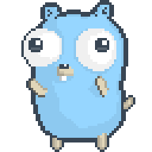

# ☕ Guilherme Augusto

### Desenvolvedor Front-End | Web & Mobile

Olá! Sou Guilherme Augusto, desenvolvedor com formação técnica em Informática para Internet pelo SENAI e apaixonado por tecnologia.

Atualmente, desenvolvo projetos web e mobile utilizando tecnologias como **React, React Native, Expo, JavaScript e TypeScript**. Estou sempre buscando aprimorar minhas habilidades, explorar novas ferramentas e construir aplicações que unam funcionalidade, desempenho e uma boa experiência para o usuário.

Também estou aprofundando meus conhecimentos em **Golang**, expandindo minha base de programação e explorando novas possibilidades no desenvolvimento de software.

## 🚀 Tecnologias e ferramentas

  
  
  
  
  
  
  
  
  
  

## 🛠️ IDEs e ferramentas de desenvolvimento

  

## Aprendendo Golang

Atualmente, estou estudando Go e aprofundando meus conhecimentos em lógica de programação, estruturas, métodos, ponteiros e orientação a objetos.

  

---

  💻 Sempre Aprendendo, Desenvolvendo e Evoluindo.

